
<b><a href="scienista-2.0.0.apk">Scienista</a> is an Android app for everyday research in computational and experimental (bio)chemistry, organised in five suites and tied together by a control center. You choose whether it shows the computational apps, the experimental ones, or both. This guide gives a short tour of each part. </b>

 The name comes from the Latin <i>scientia</i>, knowledge, the root of "science". 

 The suites are a lab notebook, a literature hub, a workbench (HPC jobs on one side, the bench on the other), a structure studio and a paper kit. The app works offline apart from the online lookups (Crossref, OpenAlex, RCSB PDB, UniProt, AlphaFold DB and PubChem), keeps all data on the phone, and has no account and no tracking. The screenshots use made-up example data for a fictional researcher: the people, projects, results, protocols, inventory and the papers shown in the control center are invented, while the literature hub screenshots show real publications with illustrative radar results and citation figures. 

---

 
<h2> 
 <b>I - Installation</b> 
</h2>

 

 Scienista needs Android 8.0 or newer. Download the scienista-X.Y.Z.apk file from the <i>Releases</i> page of the repository on the phone, open it and allow the install when Android asks. The app is signed by its author rather than distributed through the Play Store, so Android shows a warning and Play Protect may offer to scan it; you install it at your own risk. The only permission it asks for is Internet access, for the online lookups. 

 The launcher gets six icons: <b>Scienista</b> (the control center), <b>Lab notebook</b>, <b>Literature hub</b>, <b>Workbench</b>, <b>Structure studio</b> and <b>Paper kit</b>. Each opens in its own window, so you can switch between them from the recent apps screen, and all of them share the same data. To update, install the newer APK over the old one and your data stays. Version 2.0 is signed with a new key, so if you have version 1.0 installed, make a backup first (control center, Backup, <i>Download everything as one file</i>; version 1.0 saves it in its own folder under Download), uninstall 1.0, install 2.0 and restore that file from the Backup view; later updates install straight over 2.0. 

 In every suite the apps sit in a bar at the bottom of the screen, next to a <b>Backup</b> button. Most apps have a ⋮ menu with exports and <i>Export backup</i> / <i>Import backup</i>, and a + button to add something new. The back button closes an open sheet before leaving the page, and files the apps save (exports, scripts, figures) go to Download/Scienista/. 

 
<h2> 
 <b>II - Computational, experimental or both</b> 
</h2>

 

 The first time you open the app it asks how you work. <b>Computational</b> shows the HPC tracker, job scripts, benchmarks, commands, script plans and the QM/MM builder. <b>Experimental</b> shows protocols with run mode and timers, bench calculators, assay fitting, and an inventory with freezer boxes. <b>Hybrid</b> shows everything; the workbench then gets an <i>HPC</i> and <i>Lab</i> switch in its bottom bar, and Today shows both sides. The notebook, literature hub, structure viewer, watcher, calculators and paper kit are there in every profile. 

 The choice only changes which apps you see. Data in hidden apps is kept and still backed up, and you can switch at any time from the profile chip on Today or under Settings. 

 

    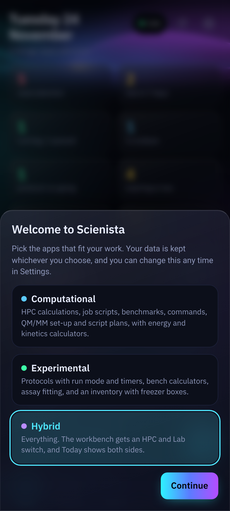
    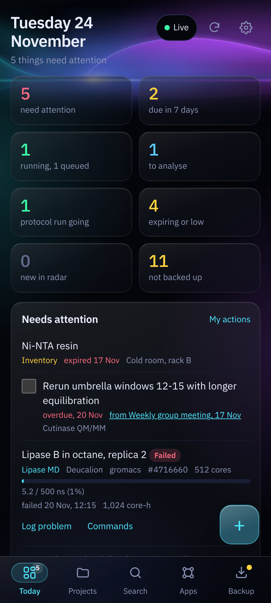
    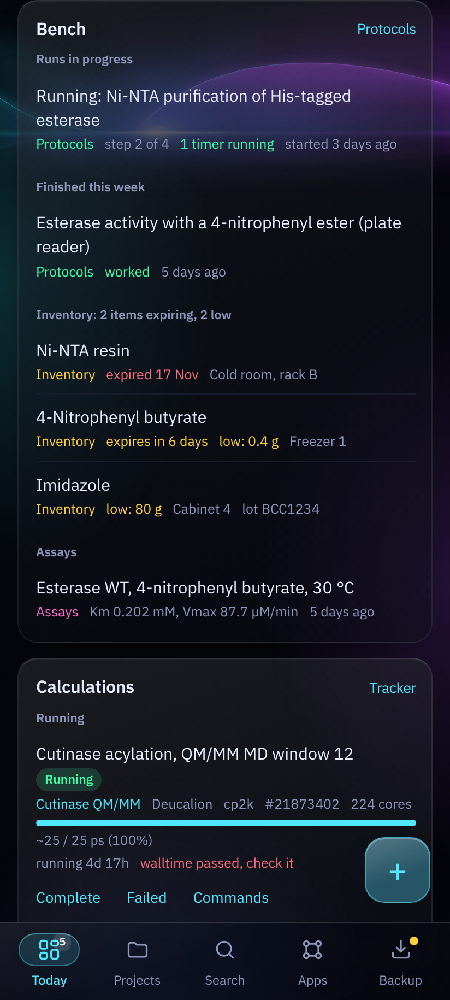

 
<h2> 
 <b>III - Control center</b> 
</h2>

 

 The place to start the day. <b>Today</b> shows what needs attention (passed deadlines, overdue action items, failed jobs, allocations running out early, expired reagents, finished timers), an agenda for the next 14 days, running and queued calculations, protocol runs in progress, reagents that expire or run low, recent assay fits, and new papers and structures. <b>Projects</b> gathers everything linked to one project across all apps, <b>Search</b> looks through every app at once (protocols, inventory and assays included), <b>Apps</b> opens any suite at the right app, and <b>Backup</b> backs everything up or restores it. 

 The + button adds a log entry, idea, deadline, calculation, command, inventory item or paper without opening the suite. Papers are looked up in Crossref by DOI or title words, and you pick the right one from the list of matches. Settings (the palette icon) holds the profile, the look, your name for <i>My actions</i>, your OpenAlex key and the privacy controls. 

 

    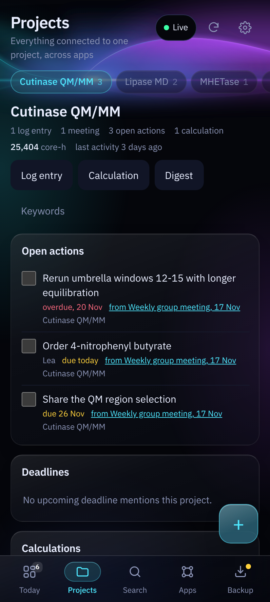
    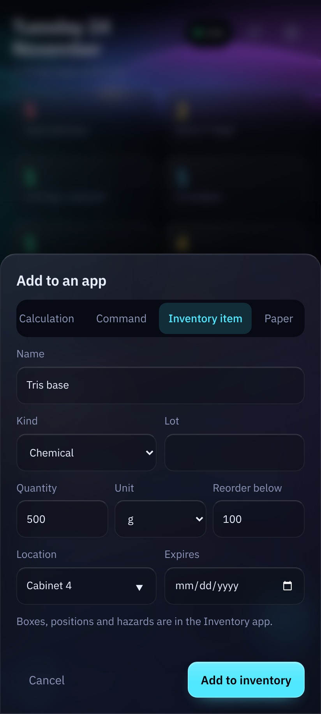
    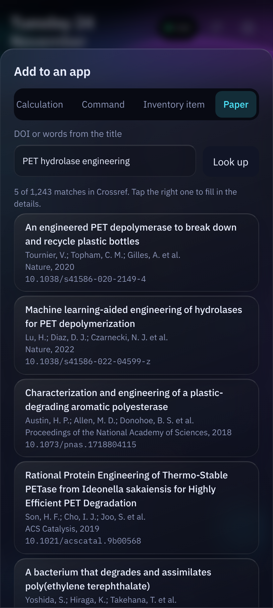

 
<h2> 
 <b>IV - Lab notebook</b> 
</h2>

 

<b>Research log:</b> dated entries (notes, results, problems, fixes, decisions) sorted by project, with #tags, pins and filters, plus meeting notes with people, decisions and action items. The Actions tab collects the open actions from every meeting, grouped by due date, and a follow-up meeting brings along whatever is still open. 

<b>Ideas:</b> a board with four stages (sparks, exploring, doing, done), categories, tags and favourites. 

<b>Script plans</b> (computational): plan a Python or Bash script (inputs and outputs, command-line options, functions, steps and checks) and get a skeleton with a complete argument parser to start from. 

<b>Protocols</b> (experimental): step-by-step protocols with reagents, categories, tags and versions. Paste steps from a paper or a kit manual and durations such as "incubate 30 min" become timers. <i>Run mode</i> turns a protocol into a checklist: scale the reagents (×0.5 to ×10 or any factor), tick steps as you go, and start as many timers as you need. Timers keep running when you leave the app, beep when they finish, and keep the screen on during a run. Finishing a run records the outcome and can add a summary to the research log. Editing a protocol that has runs makes a new version, so every run keeps the version it used. A few general templates (transformation, SDS-PAGE, Bradford, Ni-NTA purification, an esterase assay, PCR) are starting points to adapt. 

<b>Deadlines:</b> grant calls, abstracts, reports and teaching, with countdowns, yearly repeats and export to a calendar file. 

 

    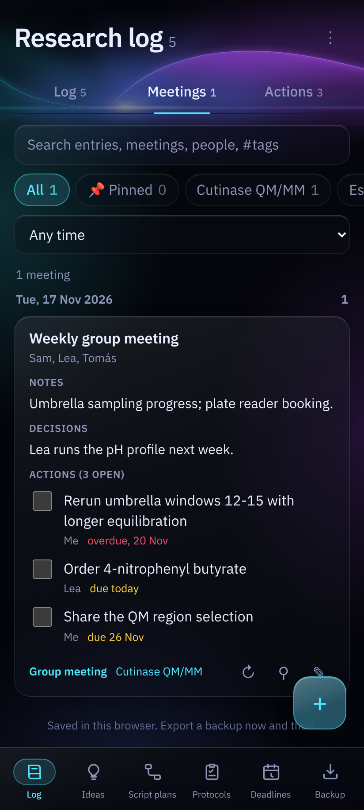
    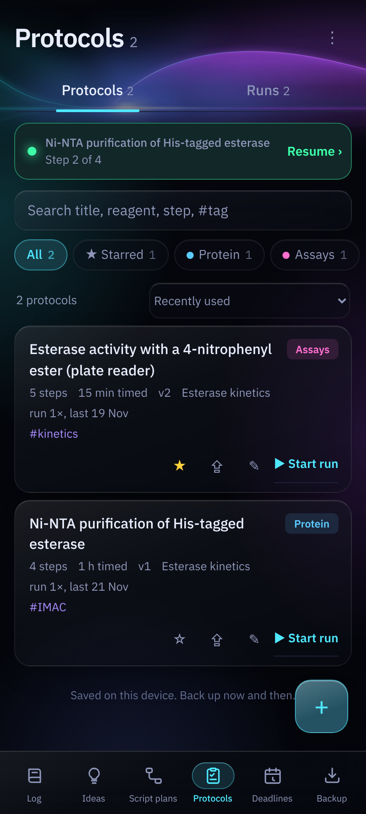
    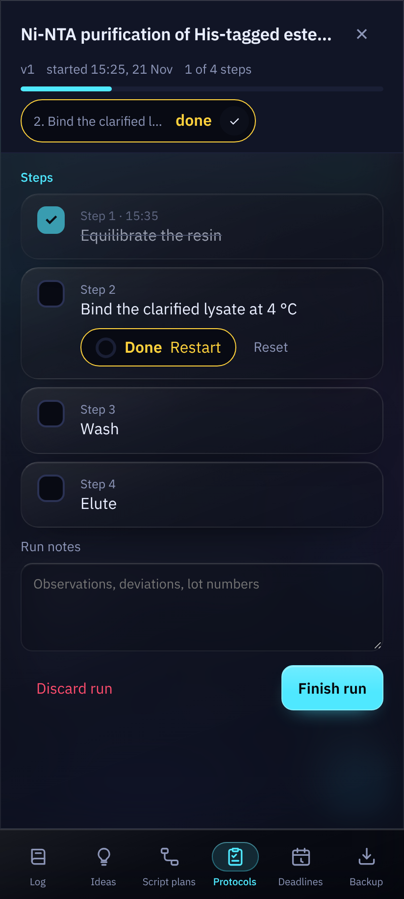

 

    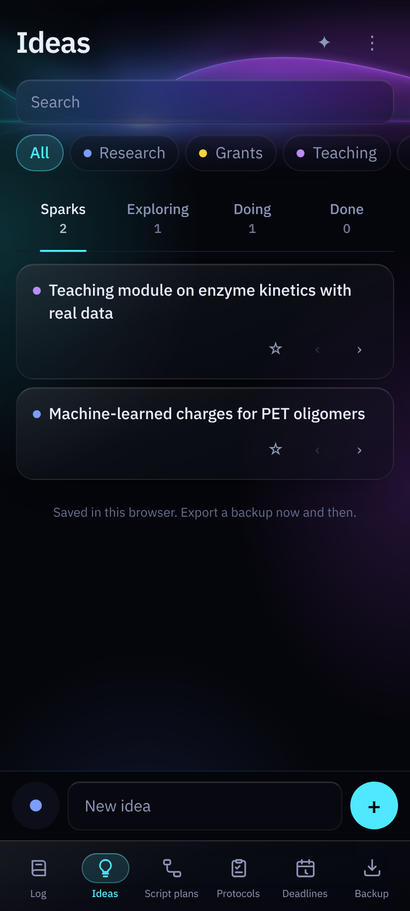
    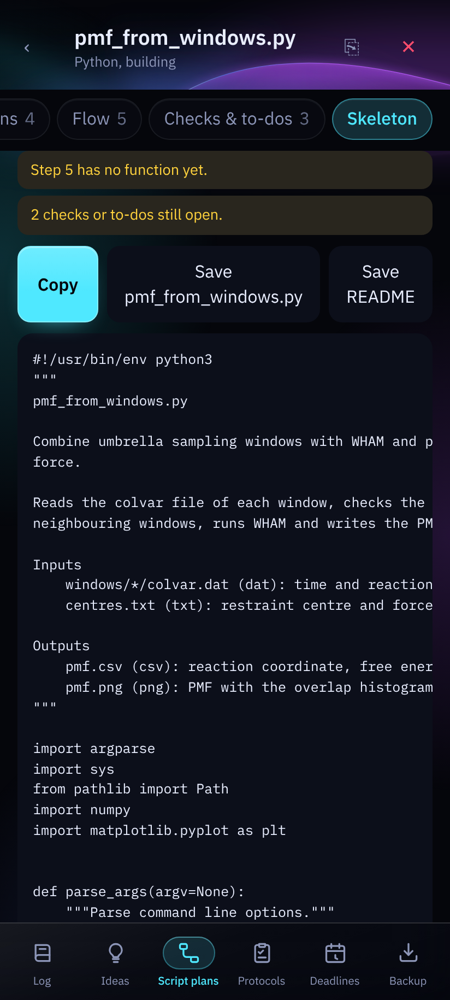

 
<h2> 
 <b>V - Literature hub</b> 
</h2>

 

<b>Papers:</b> your library, with collections and stars. Add papers by DOI or by searching Crossref, copy DOIs and citations, and export BibTeX, RIS or CSV. 

<b>Radar:</b> follows topics such as <code>PETase OR cutinase</code> in OpenAlex and marks new papers until you have seen them, with filters for dates, paper types, open access and citations. One tap saves a paper to the library. 

<b>Citations:</b> your OpenAlex author profile, with citations, h-index, i10-index, yearly charts and the citations each work gained since the last check. 

 

    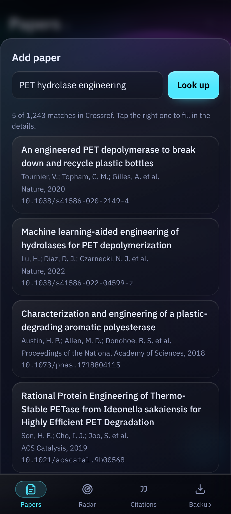
    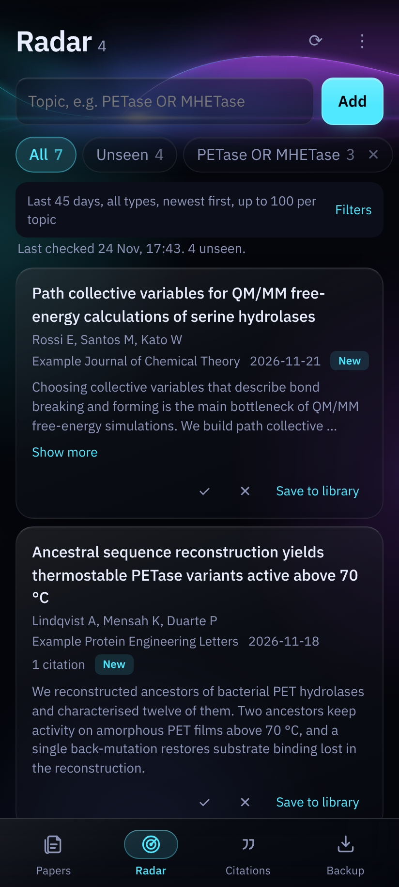
    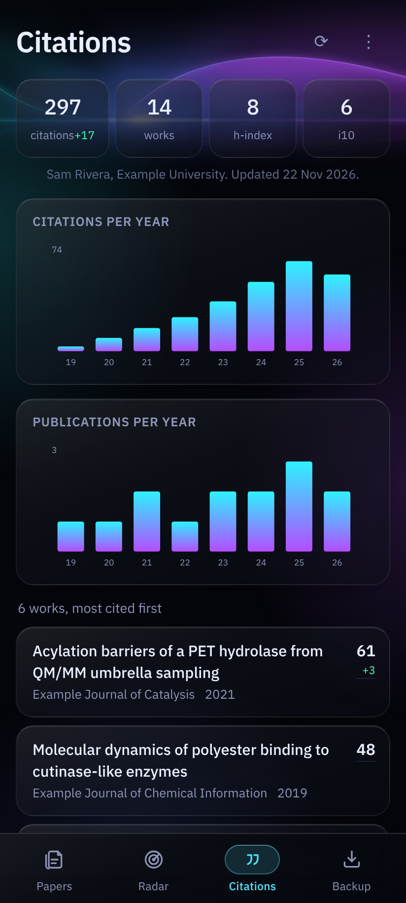

 
<h2> 
 <b>VI - Workbench</b> 
</h2>

 

 The HPC side is for computational work, the Lab side for the bench; in the hybrid profile a switch in the bottom bar moves between them. 

<b>Tracker:</b> every calculation with its cluster, resources, walltime and progress. It estimates progress and finishing time from the rate, warns when a walltime runs out and counts core-hours. Allocations get a projection of how fast you are using them. 

<b>Job scripts:</b> SLURM or PBS scripts for Gaussian, ORCA, CP2K, GROMACS, AMBER or any command, with presets for your clusters and warnings about common mistakes. 

<b>Benchmarks:</b> ns/day for each setup, the cost per ns, the fastest and cheapest options, and the wall time and cost of the run you are planning. 

<b>Commands:</b> the commands you keep looking up, with blanks such as <code>{tpr}</code> that you fill in before copying; the last values are remembered. 

<b>Calculators</b> (every profile): around 30 calculators with unit choices and a note on the formula; those that relate several quantities solve for whichever one you leave out. On the bench side: mass, concentration and volume (molar masses from a formula, a list of common reagents, your own compounds or PubChem), dilutions and serial dilutions, a concentration converter, buffer recipes by Henderson-Hasselbalch with the temperature dependence of the pKa, protein and nucleic-acid concentrations from absorbance, ligation ratios, master mixes, rpm and g, culture OD and cell counts, and enzyme activity from ΔA/min. On the computational side: energy units, Boltzmann populations, Eyring barriers and half-lives, selectivity from ΔΔG‡, ΔG and equilibrium constants with the standard-state correction, redox potentials, and ions and waters for a simulation box. 

<b>Assays</b> (experimental): fit Michaelis-Menten, Hill, substrate inhibition, one-site binding, dose-response (IC50 or EC50), linear, quadratic and four-parameter standard curves, exponential decay and one-phase association, on the phone. Paste replicate columns from a plate reader or spreadsheet, leave rows out with a tap, weight by 1/y² if the error grows with the signal, or fix a parameter. Results come with standard errors, 95 % confidence intervals and warnings when the data cannot define a parameter; kcat and kcat/Km follow from the enzyme concentration, and unknowns are read off standard curves. Each fit exports a 600 dpi figure, an SVG, a CSV or a complete Python script that repeats the fit with SciPy. 

<b>Inventory</b> (experimental): chemicals, solutions, enzymes, antibodies, kits, plasmids, strains, cell lines, primers and samples, with CAS (check digit verified), supplier, lot, quantity and reorder level, storage temperature and place, dates, hazard pictograms and a usage history. <i>Boxes</i> map freezer boxes, racks or plates position by position. Expiring and low items show up on Today. A spreadsheet you already keep comes in as CSV, and the list goes out as CSV. 

 

    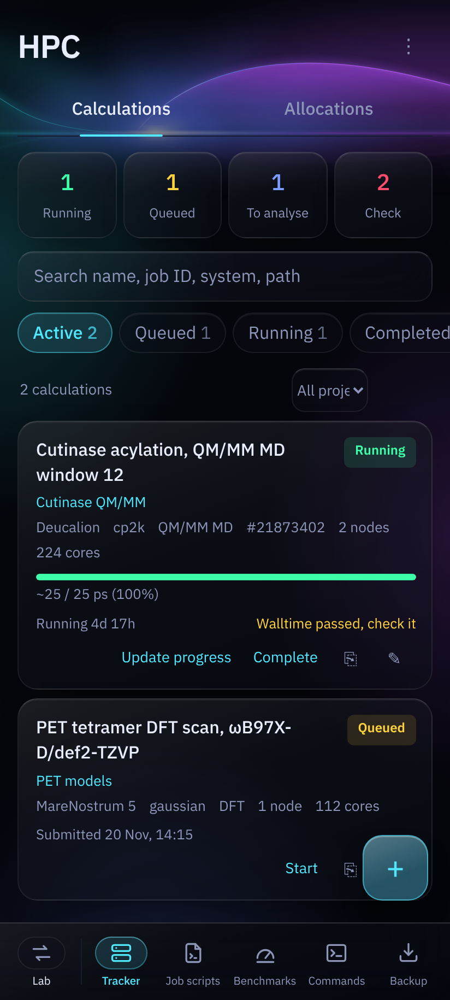
    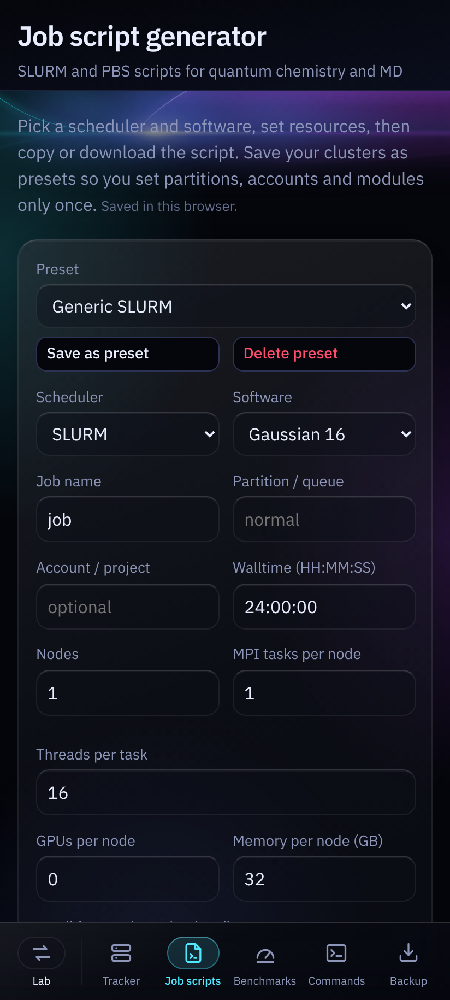
    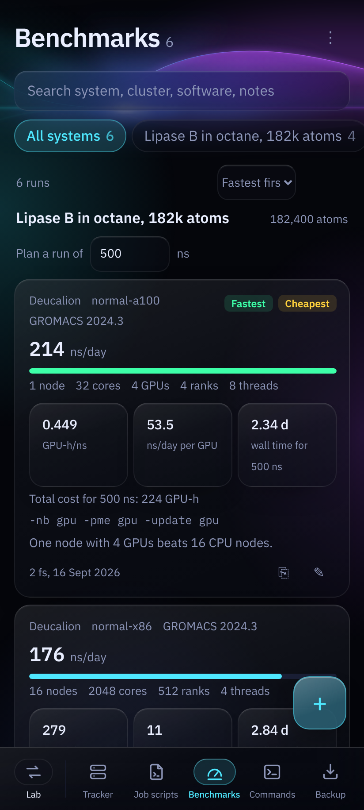

 

    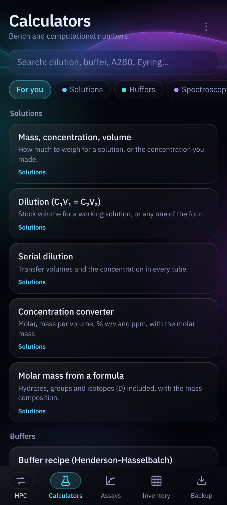
    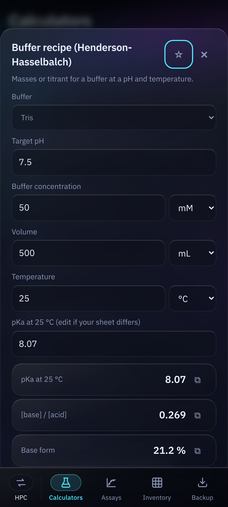
    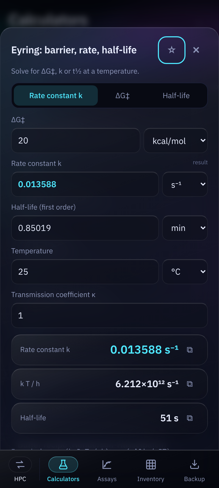

 

    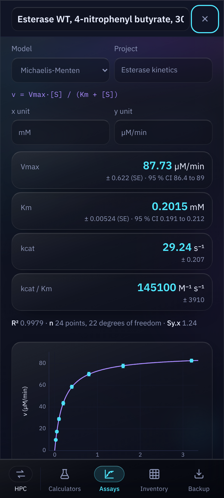
    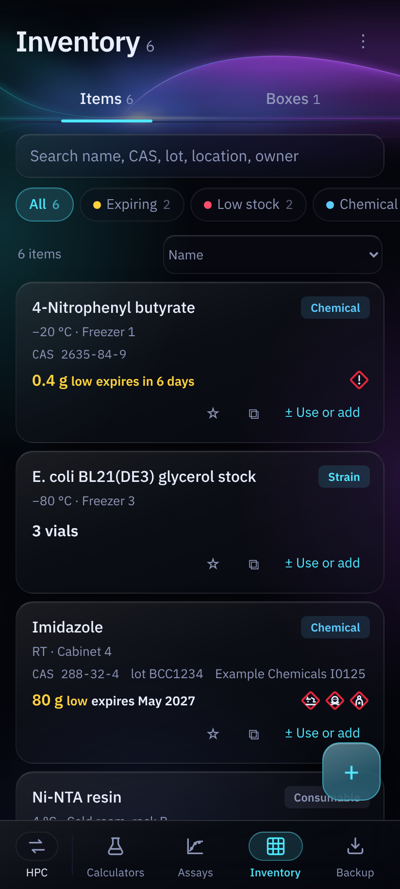
    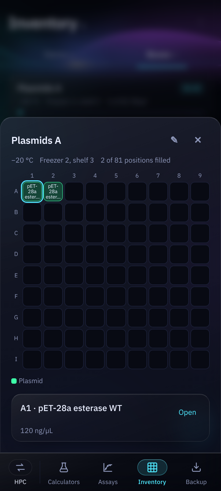

 
<h2> 
 <b>VII - Structure studio</b> 
</h2>

 

<b>Viewer:</b> a 3D viewer (3Dmol.js) for PDB, mmCIF, GRO, XYZ, SDF, MOL2 and PQR files. It opens PDB entries, AlphaFold models and PubChem compounds by ID, or searches all three by keyword. It has the usual styles and colourings, surfaces, ligand pockets, residue selections, distances and angles, trajectory frames and PNG snapshots. 

<b>QM/MM</b> (computational): pick the QM region on a protonated structure by tapping or typing residues, choose where each residue is cut, and follow a running count of QM atoms, link atoms, charge, electrons and multiplicity, with every boundary checked. It writes Gaussian ONIOM input, a CP2K QM/MM section, Amber, VMD and GROMACS selections, and an XYZ file of the QM region. 

<b>Watcher:</b> saved searches (words, EC numbers, UniProt accessions or a sequence) that flag new structures in the PDB and new sequences in UniProt, ready to open in the viewer. 

 

    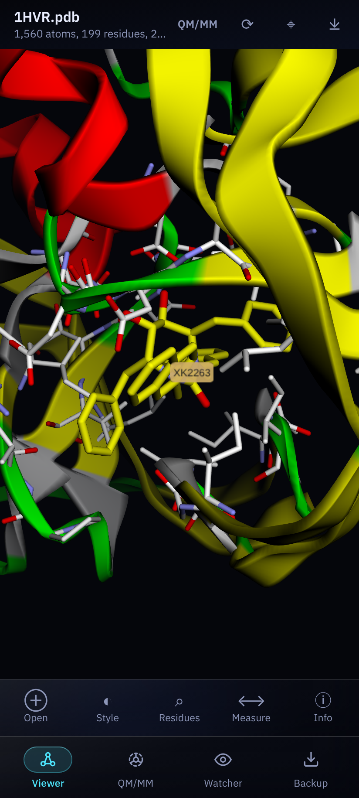
    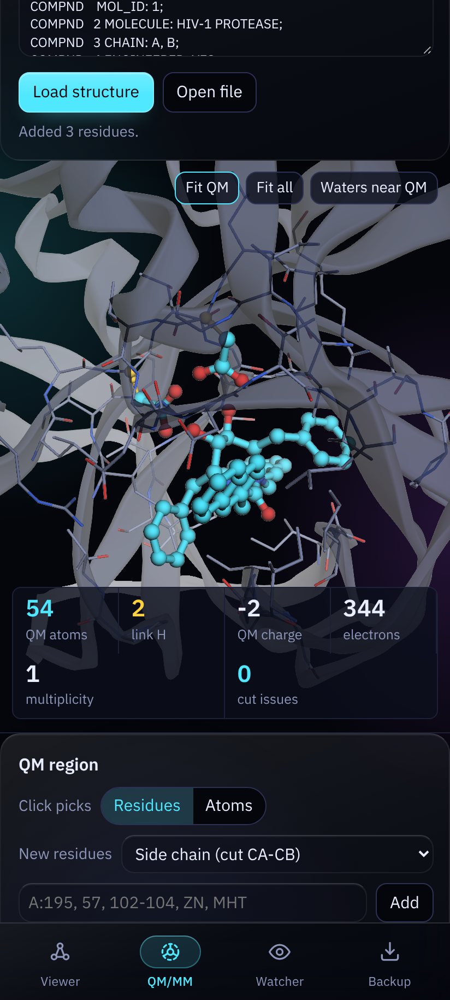
    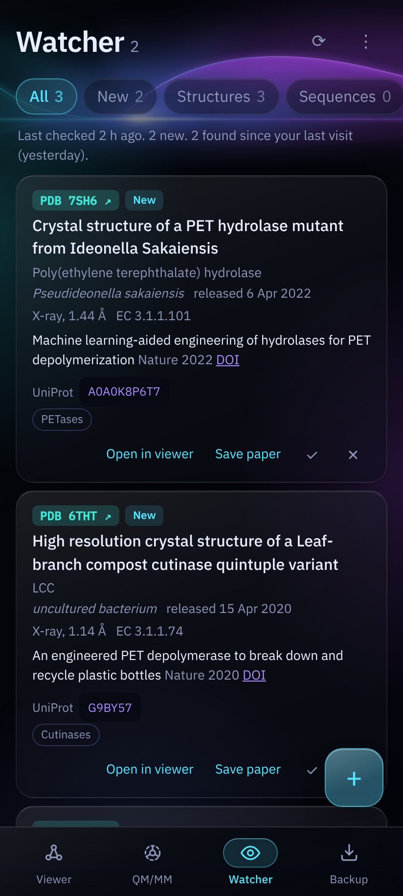

<i>The viewer shows HIV-1 protease with its inhibitor (PDB 1HVR); the QM/MM example is the zinc site of a zinc finger (PDB 5A7U, with hydrogens added).</i>

 
<h2> 
 <b>VIII - Paper kit</b> 
</h2>

 

<b>Plot guide:</b> 37 chart types, each with a tested Python script that draws it from example data and saves a 600 dpi PNG. The <i>Lab data</i> group covers Michaelis-Menten fits, dose-response curves, standard curves with unknowns, growth curves, thermal melts with Tm, and bar charts that show every replicate with t-tests. 

<b>Schemes:</b> an editor for reaction mechanisms with bonds, lone pairs, charges, curved arrows, reaction arrows and transition-state brackets, exported as SVG or 600 dpi PNG. 

<b>Journals:</b> 52 journals, including biochemistry, molecular biology and analytical titles, to filter by scope, citation impact (OpenAlex 2-year mean citedness, close to but not the same as the Impact Factor), open access cost and speed. You can edit the values and add your own journals. 

 

    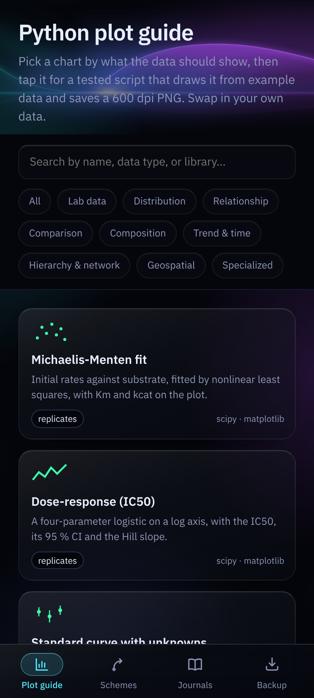
    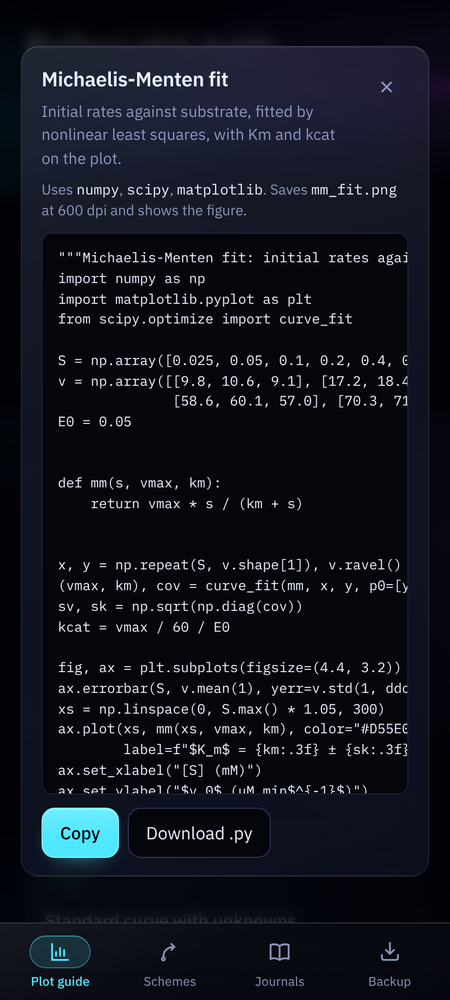
    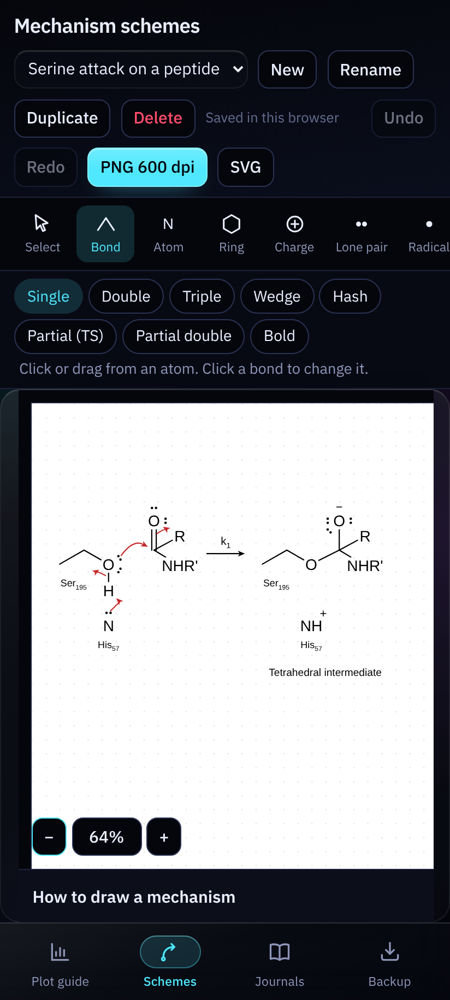

 
<h2> 
 <b>IX - Backups, looks and privacy</b> 
</h2>

 

 Your data lives only on the phone, so keep copies. The app backs up each app automatically to dated files, a few seconds after its data changes, and copies them to Download/Scienista/backups/. These copies stay on the phone even if the app is uninstalled, which deletes the data kept inside the app. The <b>Backup</b> button in each suite shows the latest file for each app and restores any earlier one. The control center's Backup view can also restore from a file you pick, and its <b>Download everything as one file</b> saves all apps in a single file; use it to move to a new phone. 

 Settings offers dark, light or match device, and eleven palettes: six neon ones named after things that glow, in the lab and in the sky (Cherenkov, Rhodamine, Fluorescein, Cy5, DAPI and Aurora, the green and red of the polar lights) and the five softer palettes of version 1. Whatever the palette, the app looks the same otherwise. Everything is made of glass: items sit on translucent, tinted panels with a bright top edge, over soft fields of the palette colours, and sheets, menus, the search field and the bottom bar are frosted. One typeface runs throughout (IBM Plex Sans, with IBM Plex Mono for code), and a neon horizon sits behind each page header (a line of light with a soft flare a third of the way across, a dome of light rising to the right and its reflection on a glassy floor), drawn in the colours of the palette. The choice applies at once to every suite, including windows that are already open, and to the status bar. 

 

    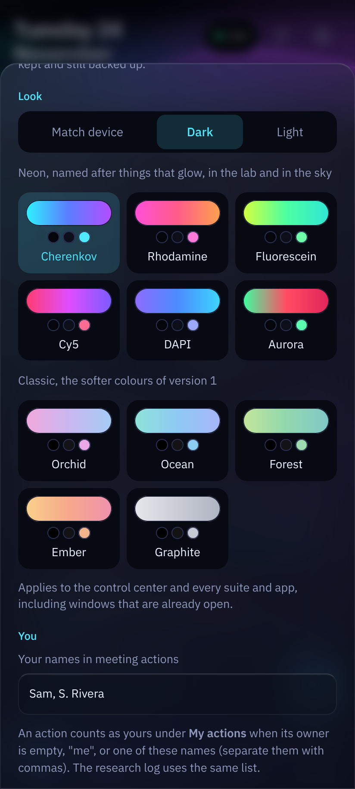
    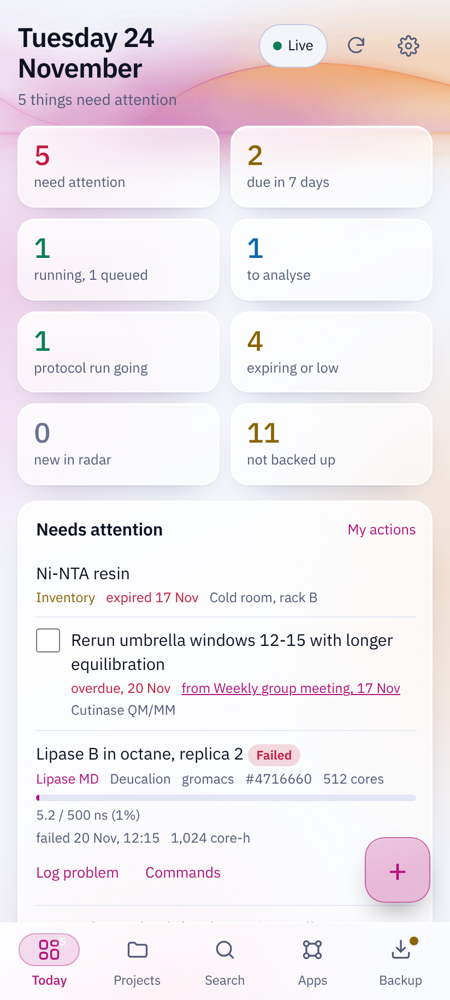
    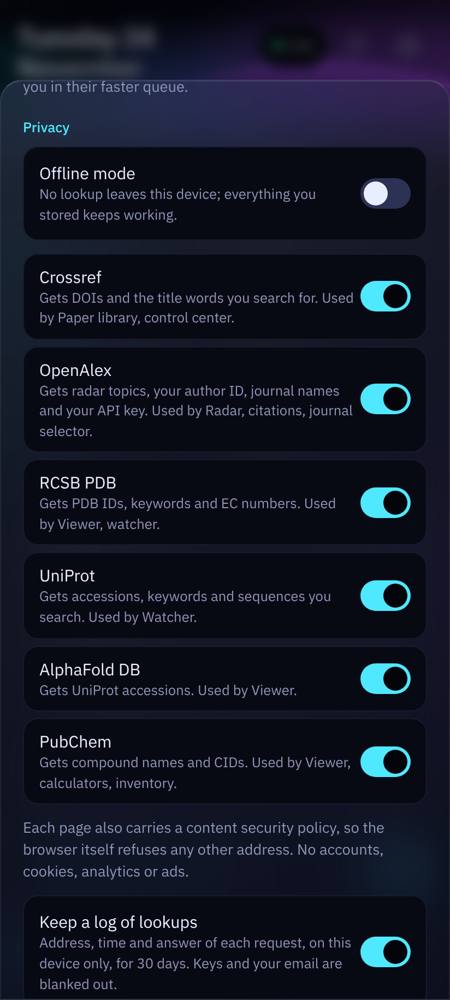

 

 Nothing leaves the phone unless you use a lookup, and then the service receives only what the request needs. Papers come from Crossref; the radar, citations and journal figures from OpenAlex; structures from RCSB PDB, UniProt, AlphaFold DB and PubChem; molar masses and compound details in the calculators and the inventory from PubChem. OpenAlex needs a free API key: sign in at <a href="https://openalex.org/settings/api" target="_blank">openalex.org/settings/api</a>, copy the key and paste it in the control center's Settings. It stays on the phone and is never written into backup files. 

 Settings, Privacy has: <b>offline mode</b>, which stops every lookup while everything you stored keeps working; a switch for each service; and a <b>log of lookups</b> (address, time and answer of each request, kept on the phone for 30 days, with keys and your email blanked out). Each page also carries a content security policy, so the WebView itself refuses any address other than these six services. <b>Backup encryption</b> protects the backup files with a passphrase (AES-256-GCM with a key derived by PBKDF2): the key stays on the phone and the passphrase is never stored, so write it down, because encrypted backups cannot be restored on a new phone without it. <b>Erase everything</b> removes all data, settings, keys and the log from the app in one step; backup files already saved in Download/Scienista stay where they are. 

 
